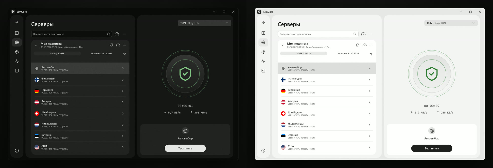
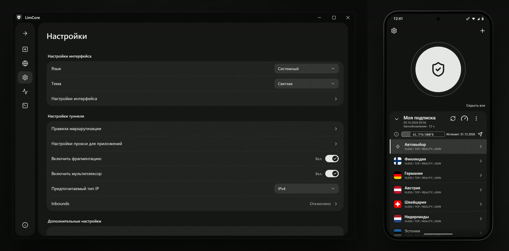

<div align="center">


### Один стиль. Все устройства. Ваши серверы.

[](#скачать)
[](#скачать)
[](#скачать)
[](#скачать)
[](https://t.me/LimCoreChannel)

<a href="#скачать"></a> <a href="#возможности"></a> <a href="#интерфейс"></a> <a href="#проверка-файлов"></a> <a href="#что-нового"></a> <a href="#поддержать-проект"></a>

</div>

https://github.com/user-attachments/assets/ca1b69c9-05c6-4086-bf7d-161719925178

## Скачать

<!-- auto:download -->
<table>
  <tr>
    <td align="center" width="25%">
      <h3>Android</h3>
      <a href="https://github.com/l-limon-l/LimCore-Android/raw/main/apk/LimCore-universal.apk"></a>
      <p><b>2.2.3</b> · 17.10.2026 · 47,0 МБ<br /><sub>Android 8.0 и новее</sub></p>
    </td>
    <td align="center" width="25%">
      <h3>Windows</h3>
      <a href="https://github.com/l-limon-l/LimCore-Desktop/raw/main/installer/LimCore-Setup.exe"></a>
      <p><b>2.6.0</b> · 16.10.2026 · 55,8 МБ<br /><sub>Установщик, обновляется сам</sub></p>
    </td>
    <td align="center" width="25%">
      <h3>Linux · Steam Deck</h3>
      <a href="https://github.com/l-limon-l/LimCore-Linux/raw/main/appimage/LimCore-x86_64.AppImage"></a>
      <p><b>2.6.0</b> · 16.10.2026 · 87,6 МБ<br /><sub>SteamOS, Arch, Fedora, Ubuntu 22.04 и новее</sub><br /><sub>Пакеты: <a href="https://github.com/l-limon-l/LimCore-Linux/raw/main/deb/LimCore-x86_64.deb">.deb</a> · <a href="https://github.com/l-limon-l/LimCore-Linux/raw/main/rpm/LimCore-x86_64.rpm">.rpm</a></sub></p>
    </td>
    <td align="center" width="25%">
      <h3>OpenWrt · роутеры</h3>
      <a href="#установка-на-роутер"></a>
      <p><b>2.3.2</b> · 13.10.2026 · 0,3 МБ<br /><sub>OpenWrt 23.05 и новее, LuCI</sub><br /><sub>Пакеты: <a href="https://github.com/l-limon-l/LimCoreWRT/raw/main/packages/luci-app-limcore_all.apk">.apk</a> · <a href="https://github.com/l-limon-l/LimCoreWRT/raw/main/packages/luci-app-limcore_all.ipk">.ipk</a> · <a href="https://github.com/l-limon-l/LimCoreWRT/raw/main/packages/luci-app-limcore_all-legacy.ipk">-legacy.ipk</a></sub></p>
    </td>
  </tr>
</table>
<!-- /auto:download -->

<details>
<summary><b>Сборки под конкретный процессор</b> — меньше по размеру</summary>

<!-- auto:abis -->
| Сборка | Для каких устройств | Размер |
|---|---|---|
| [arm64-v8a](https://github.com/l-limon-l/LimCore-Android/raw/main/apk/LimCore-arm64-v8a.apk) | Почти все телефоны последних лет | 22,2 МБ |
| [armeabi-v7a](https://github.com/l-limon-l/LimCore-Android/raw/main/apk/LimCore-armeabi-v7a.apk) | Старые 32-битные телефоны | 22,7 МБ |
| [x86_64](https://github.com/l-limon-l/LimCore-Android/raw/main/apk/LimCore-x86_64.apk) | Эмуляторы и планшеты на x86 | 23,2 МБ |
| [universal](https://github.com/l-limon-l/LimCore-Android/raw/main/apk/LimCore-universal.apk) | Любое устройство | 47,0 МБ |
<!-- /auto:abis -->

Не знаете, какая нужна, — берите **universal**, она работает везде.

</details>

**Установка на Android:** скачайте APK, откройте его и разрешите установку из этого источника, если телефон спросит.
**Установка на Linux и Steam Deck:** скачайте AppImage, разрешите его запуск (Свойства → Права → Исполняемый) и откройте: запустится установщик. На Steam Deck установка идёт в режиме рабочего стола; для службы TUN нужен пароль пользователя, его задают в Konsole командой `passwd`. После установки LimCore появляется в библиотеке Steam и работает в игровом режиме.
**Пакеты .deb и .rpm:** для Debian, Ubuntu и Linux Mint — `sudo apt install ./LimCore-x86_64.deb`, для Fedora и openSUSE — `sudo dnf install ./LimCore-x86_64.rpm` (или `zypper`). Служба TUN настраивается при установке пакета.
**Обновления:** все приложения сами проверяют новые версии, скачивать заново вручную не нужно.

### Установка на роутер

LimCore для OpenWrt 23.05 и новее: приложение LuCI на ядре sing-box, с ByeDPI и Zapret. Выполните команду на роутере по SSH, установщик сам выберет пакет под версию OpenWrt и поставит ядро:

<!-- auto:install -->
```sh
wget -qO- https://raw.githubusercontent.com/l-limon-l/LimCoreWRT/main/install.sh | sh
```
<!-- /auto:install -->

После установки LimCore открывается в LuCI: **Службы → LimCore**. Обновления ставятся из интерфейса или сами по расписанию.

## Возможности

<table>
  <tr>
    <td width="50%" valign="top">
      <b>⚡ Один тап до подключения</b><br />
      Автовыбор сервера и тест пинга сами находят лучший вариант.
    </td>
    <td width="50%" valign="top">
      <b>📥 Подписки</b><br />
      Импорт подписок и ссылок, автообновление, остаток трафика и срок действия.
    </td>
  </tr>
  <tr>
    <td valign="top">
      <b>🧩 Ядро Xray-core</b><br />
      VLESS, REALITY и другие протоколы Xray, конфигурации в JSON.
    </td>
    <td valign="top">
      <b>⚙️ Тонкая настройка</b><br />
      Фрагментация, мультиплексор, маршрутизация, MTU, IPv6.
    </td>
  </tr>
  <tr>
    <td valign="top">
      <b>📱 Раздельное туннелирование</b><br />
      Выберите приложения, которые работают через подключение, а какие напрямую.
    </td>
    <td valign="top">
      <b>🎨 Один стиль</b><br />
      Одинаковый интерфейс на Android, Windows и Linux, светлая и тёмная темы.
    </td>
  </tr>
</table>

## Интерфейс





## Проверка файлов

Исходный код закрыт, поэтому для каждого файла опубликован SHA-256. Сравните его с хешем скачанного файла или откройте готовый отчёт VirusTotal:

<!-- auto:hashes -->
| Файл | SHA-256 | Проверка |
|---|---|---|
| `LimCore-Setup.exe` | <sub>`0591cec9d14db862193da3c6172b3eec40b989fe00e41d42f5e1146d5414a45a`</sub> | [VirusTotal](https://www.virustotal.com/gui/file/0591cec9d14db862193da3c6172b3eec40b989fe00e41d42f5e1146d5414a45a) |
| `LimCore-x86_64.AppImage` | <sub>`ff234aab8f43c4c3f36902c8dfe4b27421d0b84c7a2b0b24e504c10e4a8fb747`</sub> | [VirusTotal](https://www.virustotal.com/gui/file/ff234aab8f43c4c3f36902c8dfe4b27421d0b84c7a2b0b24e504c10e4a8fb747) |
| `LimCore-x86_64.deb` | <sub>`420d743a90afb546a5febfccaaab2c1b1239ddf0cce2e71a44d56d966563ccfe`</sub> | [VirusTotal](https://www.virustotal.com/gui/file/420d743a90afb546a5febfccaaab2c1b1239ddf0cce2e71a44d56d966563ccfe) |
| `LimCore-x86_64.rpm` | <sub>`a6e6d974c9a1e39415e289a55cd6c78b7580e289693b1f82f3d145352a67e8e0`</sub> | [VirusTotal](https://www.virustotal.com/gui/file/a6e6d974c9a1e39415e289a55cd6c78b7580e289693b1f82f3d145352a67e8e0) |
| `LimCore-universal.apk` | <sub>`ab796cddfb3a61191d95e579f4f4991421543ab1789115dd1b67bc12b1d56281`</sub> | [VirusTotal](https://www.virustotal.com/gui/file/ab796cddfb3a61191d95e579f4f4991421543ab1789115dd1b67bc12b1d56281) |
| `LimCore-arm64-v8a.apk` | <sub>`8f4bfffdb38c9d899ddf8aaabfc36d1ce0bb93c5a8bd8b54401443a43f24cad9`</sub> | [VirusTotal](https://www.virustotal.com/gui/file/8f4bfffdb38c9d899ddf8aaabfc36d1ce0bb93c5a8bd8b54401443a43f24cad9) |
| `LimCore-armeabi-v7a.apk` | <sub>`0c28634ea97bd0b75719b7fa5df22fa882e715471866caba3b3a907ee01d949a`</sub> | [VirusTotal](https://www.virustotal.com/gui/file/0c28634ea97bd0b75719b7fa5df22fa882e715471866caba3b3a907ee01d949a) |
| `LimCore-x86_64.apk` | <sub>`fbe693219ee732e4612698c4128df391bad7d33eaaeddae630dbd3fba0f86383`</sub> | [VirusTotal](https://www.virustotal.com/gui/file/fbe693219ee732e4612698c4128df391bad7d33eaaeddae630dbd3fba0f86383) |
| `luci-app-limcore_all.apk` | <sub>`49416adbf4d395069ac37c6400955c353691d1bc54382e215de32dffed69ae48`</sub> | [VirusTotal](https://www.virustotal.com/gui/file/49416adbf4d395069ac37c6400955c353691d1bc54382e215de32dffed69ae48) |
| `luci-app-limcore_all.ipk` | <sub>`46c133d1c5213f3d7fe9f6a0b0dcb605956a0d68fdcb997cdc7cae1c1265d6c7`</sub> | [VirusTotal](https://www.virustotal.com/gui/file/46c133d1c5213f3d7fe9f6a0b0dcb605956a0d68fdcb997cdc7cae1c1265d6c7) |
| `luci-app-limcore_all-legacy.ipk` | <sub>`5ef2dc5b762853540690d349c95d52a84da39bba94b361aab59120a559e68a7b`</sub> | [VirusTotal](https://www.virustotal.com/gui/file/5ef2dc5b762853540690d349c95d52a84da39bba94b361aab59120a559e68a7b) |
<!-- /auto:hashes -->

```powershell
Get-FileHash .\LimCore-Setup.exe -Algorithm SHA256   # Windows
```

```bash
sha256sum LimCore-x86_64.AppImage                    # Linux, macOS, Termux (так же .deb и .rpm)
```

Таблица обновляется автоматически из `update.json` приложений: [Android](https://github.com/l-limon-l/LimCore-Android/blob/main/update.json) · [Windows](https://github.com/l-limon-l/LimCore-Desktop/blob/main/update.json) · [Linux](https://github.com/l-limon-l/LimCore-Linux/blob/main/update.json) · [OpenWrt](https://github.com/l-limon-l/LimCoreWRT/blob/main/update.json).

## Что нового

<!-- auto:changes -->
**Android 2.2.3** · 17.10.2026

- Окно загрузки обновления теперь можно скрыть кнопкой «Скрыть» и пользоваться приложением, пока новая версия скачивается. Ход загрузки виден в «О приложении» → «Проверить обновления», нажатие на эту строку возвращает окно. После загрузки система, как и раньше, попросит подтвердить установку.

**Windows 2.6.0** · 16.10.2026

- Выбор провайдера TUN, как в Happ: Xray TUN, Sing-box или tun2proxy — в меню режима на главном экране и в дополнительных настройках. Провайдер подписки может задать его сам (tun-type, tun-mode).
- «Прямое подключение для выбранных приложений» через драйвер ядра, как в Happ: трафик этих программ вообще не заходит в туннель. Включается в «Настройки прокси для приложений» → «Через драйвер ядра».
- AntiFilter (byedpi): обход DPI перед соединением с сервером, в основных настройках рядом с фрагментацией.
- QR-код из картинки: тип «QR-код» в окне добавления, а кнопки «Вставить» понимают снимок экрана с QR-кодом.
- Предупреждение, если на компьютере сбиты дата и время: из-за этого не подключаются серверы VMess и REALITY.
- Ctrl + колесо мыши меняет масштаб интерфейса.
- Иконка в трее — щит: зелёный при подключении, белый без него.
- Провайдеры подписок могут задавать режим подключения (tun-enable, proxy-enable) и список приложений для Windows (per-app-proxy-mode-windows, per-app-proxy-list-windows-add/-set).

**Linux 2.6.0** · 16.10.2026

- Выбор провайдера TUN, как в Happ: Xray TUN, Sing-box или tun2proxy — в меню режима на главном экране и в дополнительных настройках. Провайдер подписки может задать его сам (tun-type, tun-mode).
- AntiFilter (byedpi): обход DPI перед соединением с сервером, в основных настройках рядом с фрагментацией (пока в режиме системного прокси).
- QR-код из картинки: тип «QR-код» в окне добавления, а кнопки «Вставить» понимают снимок экрана с QR-кодом.
- Предупреждение, если на компьютере сбиты дата и время: из-за этого не подключаются серверы VMess и REALITY.
- Ctrl + колесо мыши меняет масштаб интерфейса.
- Иконка в трее — щит: зелёный при подключении, белый без него.
- Провайдеры подписок могут задавать режим подключения (tun-enable, proxy-enable) и список приложений для Linux (per-app-proxy-mode-linux, per-app-proxy-list-linux-add/-set).

**OpenWrt 2.3.2** · 13.10.2026

- Мультивыбор узлов: чекбоксы, выбор всех в открытой папке, групповая проверка задержки и скорости, перенос в папку и удаление с подтверждением.
- Флаги в списке узлов, обзоре и окне «Лучший узел» отображаются через локальный SVG-спрайт, независимо от emoji-шрифтов Windows и темы LuCI.
- Удалён дублирующий шрифт флагов; все изображения собраны в один файл для экономии места на роутере.
<!-- /auto:changes -->

Полная история: [Android](https://github.com/l-limon-l/LimCore-Android/blob/main/CHANGELOG.md) · [Windows](https://github.com/l-limon-l/LimCore-Desktop/blob/main/CHANGELOG.md) · [Linux](https://github.com/l-limon-l/LimCore-Linux/blob/main/CHANGELOG.md) · [OpenWrt](https://github.com/l-limon-l/LimCoreWRT/blob/main/CHANGELOG.md)

## Поддержать проект

Если LimCore вам пригодился, поддержать разработку можно любым удобным способом:

<table>
  <tr>
    <td align="center" width="50%" valign="top">
      <h3>₽ Рубли</h3>
      <a href="https://web.tribute.tg/d/Sob"></a>
      <p><sub>Через Tribute</sub></p>
    </td>
    <td align="center" width="50%" valign="top">
      <h3>$ Доллары</h3>
      <a href="https://web.tribute.tg/d/Sod"></a>
      <p><sub>Через Tribute</sub></p>
    </td>
  </tr>
  <tr>
    <td align="center" valign="top">
      <h3>Gram (бывший TON)</h3>
      <p><code>UQBIyejAbvFMPGa7ZPtgTAl8_CVLUu7HxS9MaqXxp7tnFy98</code></p>
      <p><sub>Кошелёк Gram</sub></p>
    </td>
    <td align="center" valign="top">
      <h3>USDT</h3>
      <p><code>UQBIyejAbvFMPGa7ZPtgTAl8_CVLUu7HxS9MaqXxp7tnFy98</code></p>
      <p><sub>Сеть Gram, другие сети не подходят</sub></p>
    </td>
  </tr>
</table>

## Важно

> [!NOTE]
> **LimCore — только приложение.** Оно подключается к вашим собственным серверам и подпискам. Серверы, подписки и конфигурации я не предоставляю, не продаю и не раздаю.

Исходный код закрыт. Новости и релизы — в Telegram-канале [@LimCoreChannel](https://t.me/LimCoreChannel).

---

<details>
<summary><b>English</b></summary>

<br />

**LimCore** is a client app built on Xray-core for Android, Windows and Linux (Steam Deck included), with the same look everywhere, plus a LuCI app for OpenWrt routers: one-tap connect, server auto-select, ping test, subscriptions, per-app routing, fragmentation, mux, light and dark themes.

It only connects to *your own* servers and subscriptions. No servers or subscriptions are provided. The source code is closed; SHA-256 hashes and VirusTotal reports for every file are listed above.

**Download:** [Android (universal APK)](https://github.com/l-limon-l/LimCore-Android/raw/main/apk/LimCore-universal.apk) · [Windows (Setup.exe)](https://github.com/l-limon-l/LimCore-Desktop/raw/main/installer/LimCore-Setup.exe) · [Linux / Steam Deck (AppImage)](https://github.com/l-limon-l/LimCore-Linux/raw/main/appimage/LimCore-x86_64.AppImage) · OpenWrt: `wget -qO- https://raw.githubusercontent.com/l-limon-l/LimCoreWRT/main/install.sh | sh`

</details>
